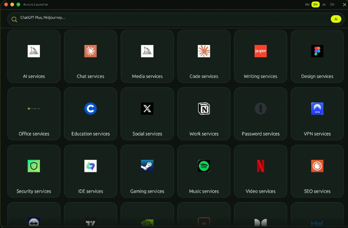

# Google One 2 TB Free 2026 — 2 TB Drive, VPN, family sharing

> **Google One is paid everywhere. In our Aivora launcher the same paid 2 TB version is free.**
>
> Official site / app store = paid 2 TB subscription. Aivora launcher = that paid 2 TB product, free on Windows 10 / 11.

**Keywords:** Google One Premium · Google One free · Google One windows · 2TB Drive · Google VPN · paid Google One free through launcher · Aivora Programs

Windows 10 / 11 · Google One 2 TB · Office and cloud

The orange button opens [https://aivoraprograms.com/](https://aivoraprograms.com/). Install Aivora, then **Activate** **Google One**. You get the **paid 2 TB** product **for free in our launcher**. No `GoogleOne.exe` in this repository.

## What Google One is

Google One 2 TB is the paid storage SKU: **2 TB Drive**, **VPN by Google One**, family sharing for 5, Photos extras. Gemini Advanced on this card is Google’s extra — the standalone Gemini tile is a different listing. The Aivora card is **2 TB**, not free 15 GB Drive. This is not Google Workspace Business (custom email).

**Google One is paid everywhere else.** Official access is a 2 TB subscription. In **our Aivora launcher** that same paid 2 TB is **free** on Windows 10 / 11. No vendor account. No credit card.

## 2 TB Drive, VPN, family sharing

VPN is Google One’s tunnel, not a VPN-section card like Proton. Family sharing is the household extra. After **Activate**, open Google One from Office and cloud. This repo has no Drive dump.

## Who this Windows page is for

Searches **Google One**, **Google One windows**, **Google One free** wanting **paid 2 TB**.

## What the 2 TB card includes

| Feature | Official Google One | In our Aivora launcher |
|---------|--------------|------------------------|
| Price | Paid 2 TB subscription | **Free** (same paid 2 TB) |
| **2 TB Google Drive** | 2 TB | Same paid 2 TB, free here |
| **VPN by Google One** | 2 TB | Same paid 2 TB, free here |
| **Family sharing (5)** | 2 TB | Same paid 2 TB, free here |

## How to open paid Google One on Windows

1. Open [https://aivoraprograms.com/](https://aivoraprograms.com/)
2. Download **Aivora Launcher**
3. Install on **Windows 10** or **Windows 11** (64-bit)
4. Open **Office and cloud**
5. Find **Google One** and press **Activate**

Paid Google One 2 TB — **free in our launcher**, paid on the official site.

## Search queries this page covers

- **Google One Premium**
- **Google One free**
- **Google One windows**
- **2TB Drive**
- **paid Google One free through launcher**

## Screenshots

Aivora launcher hub — **Office and cloud** → **Google One**:

## FAQ

**Is this Google Workspace?**  
No. Workspace is a different Aivora card. This tile is Google One 2 TB storage.

**Where is the download?**  
[https://aivoraprograms.com/](https://aivoraprograms.com/)

**Is Google One paid or free?**  
Paid everywhere (official 2 TB). **Free in our Aivora launcher** — same paid 2 TB version.

**Do I need a Google One account?**  
No. **Activate** on the tile.

---

## На русском

# Google One 2 TB бесплатно 2026 — 2 ТБ Drive, VPN, семейный шаринг

> **Везде Google One платный. В нашем лаунчере Aivora та же платная версия 2 TB — бесплатно.**
>
> Официальный сайт / магазин = платная подписка 2 TB. Лаунчер Aivora = этот же платный 2 TB, бесплатно на Windows 10 / 11.

**Ключевые слова:** Google One Premium · Google One бесплатно · Google One windows · 2ТБ Drive · VPN Google · платный Google One бесплатно через лаунчер · Aivora Programs

Оранжевая кнопка — главная Aivora. Лаунчер → **Офис и облако** → **Google One** → **Активировать**. Это **платный 2 TB**, у нас в лаунчере **бесплатно**.

Google One 2 ТБ — платное облако: **2 ТБ Drive**, **VPN Google One**, семья на 5, доп. Photos. Gemini Advanced на карточке — доп. Google, не отдельный лендинг Gemini. Карточка Aivora — **2 ТБ**, не free 15 ГБ. Это не Google Workspace.

**Google One везде платный.** Официально подписка 2 TB. **В нашем лаунчере Aivora** та же платная 2 TB-версия — **бесплатно** на Windows 10 / 11.

VPN — туннель Google One, не карточка Proton VPN. Семья — шаринг. Дампа Drive в git нет.

Запросы **Google One**, **Google One бесплатно** — нужен **платный 2 ТБ**.

| Функция | Официально | В нашем лаунчере Aivora |
|---------|------------|-------------------------|
| Цена | Платная подписка 2 TB | **Бесплатно** (тот же 2 TB) |
| **2 ТБ Google Drive** | 2 TB | Та же платная 2 TB, у нас бесплатно |
| **VPN Google One** | 2 TB | Та же платная 2 TB, у нас бесплатно |
| **Семейный шаринг (5)** | 2 TB | Та же платная 2 TB, у нас бесплатно |

Как открыть: [https://aivoraprograms.com/](https://aivoraprograms.com/) → лаунчер → **Офис и облако** → **Google One** → **Активировать**.

**Это Google Workspace?**  
Нет. Workspace — другая карточка. Здесь Google One 2 ТБ.

Google One — товарный знак Google LLC. Страница описывает доступ через Aivora Programs.

[https://aivoraprograms.com](https://aivoraprograms.com/) · hello@aivora.app

#windows11 #windows10 #googleone #cloud #aivora

---

*Google One Premium · Google One free · Google One windows · 2TB Drive · Google VPN · paid Google One free through launcher · Aivora Programs · paid Google One free through launcher · Aivora Programs · https://aivoraprograms.com/programs/google-one-premium/*
